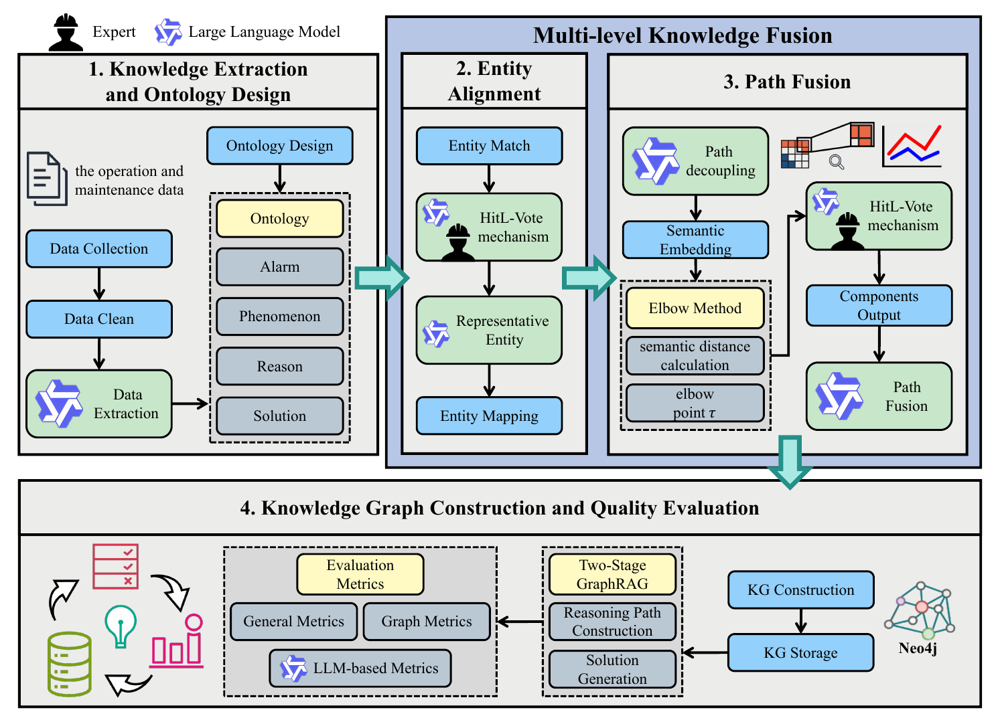

<div align="center">

# HitL-MKF

**Human-in-the-Loop Multi-level Knowledge Fusion for Domain Knowledge Graph Construction using Large Language Models**

Jialin Tao · Yuhan Liu · Yufei Liu · Jianzhong Yang<br>
*Results in Engineering*, 2026

[**Project page ↗**](https://taojialin617.github.io/hitl-mkf-project/) &nbsp; · &nbsp; [**Paper ↗**](https://doi.org/10.1016/j.rineng.2026.114056) &nbsp; · &nbsp; [**Request data & code ↗**](mailto:liuyf@cae.cn)

</div>

---

HitL-MKF combines LLM voting and expert review with **entity alignment**, **path fusion**, and **Two-Stage GraphRAG** for CNC fault diagnosis.



| Work orders | Test questions | BERT-F1 | Judge Score |
|:---:|:---:|:---:|:---:|
| 1,421 | 209 | **0.6493** | **8.1109 ± 0.0668** |

Judge Score summarizes five scoring rounds. Results are from a single CNC manufacturer; see the paper for evaluation details.

## Data & code

The evaluation datasets, including the **209-question diagnostic test set** and **100 candidate entity pairs**, are available on request. Code is also available on request, with confidential company information removed. The construction work orders are currently not publicly available because they contain confidential company information.

Contact the corresponding author: [liuyf@cae.cn](mailto:liuyf@cae.cn).

## Citation

```bibtex
@article{tao2026hitlmkf,
  title = {HitL-MKF: Human-in-the-Loop Multi-level Knowledge Fusion for Domain Knowledge Graph Construction using Large Language Models},
  author = {Tao, Jialin and Liu, Yuhan and Liu, Yufei and Yang, Jianzhong},
  journal = {Results in Engineering},
  pages = {114056},
  year = {2026},
  doi = {10.1016/j.rineng.2026.114056}
}
```

<details>
<summary>About this repository</summary>

This repository contains the static project website, paper figures and bibliographic metadata. The research implementation and industrial work-order data are not hosted here.

No build or installation is needed. Serve this directory with a static HTTP server, for example `python -m http.server 8000`. GitHub Pages publishes from `main`, `/ (root)`.

The research text, results and original figures are attributed to the authors of the linked paper. Reuse of publication content is subject to its applicable terms; this website grants no additional license for research data or implementation.

</details>
